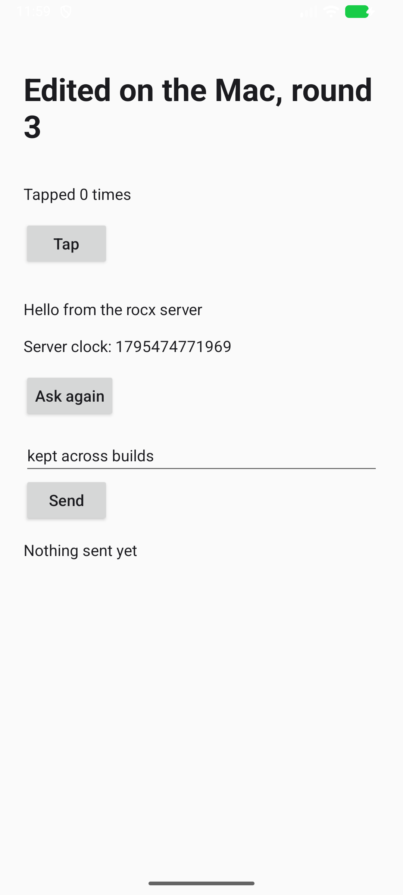
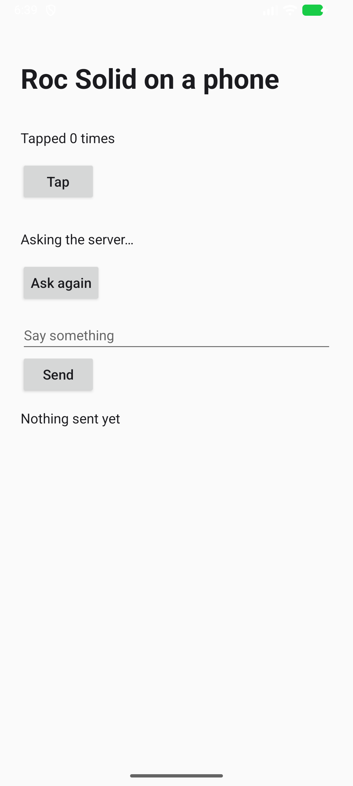
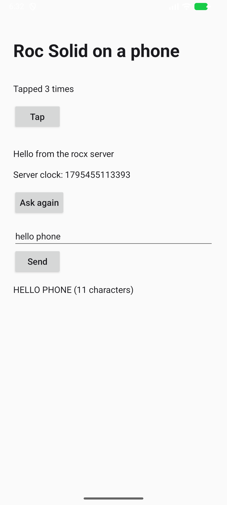
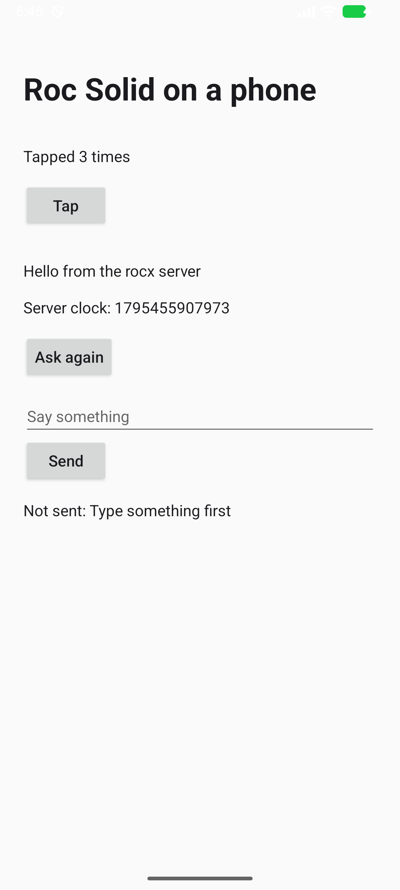

# The Android spike (D-063): a `.rocx` screen as native Android views

Built 2026-11-23 on branch `nxy7/native-android` (from `native-apps`), following
[DESIGN.md](DESIGN.md); in master since 2026-11-24, as an experiment to iterate on: nothing of it
runs unless asked for (`rocx dev --android`, `native/android/build.sh`), and the web's code paths
are the same. One screen, [phone-hello](phone-hello/), runs as real Android views on
the emulator, with no JavaScript and no WebView, and talks to the app's rocx server with the same
typed endpoint calls the browser makes (`Api`, D-037). The same `.rocx` runs unchanged in a
browser.

```
spike/native-apps/phone-hello/routes/+page.rocx
   │ rocx build --client                       (the browser's copy: main.roc on web/platform)
   ├─roc --target=wasm32 ──► app.wasm + web/runtime.js                 the browser, as before
   └─roc --target=arm64musl ──► libapp-roc.a (the app alone, an archive)
                                   │ NDK clang, with native/android + native/core (Rust)
                                   ▼
                     lib/arm64-v8a/libapp.so ──JNI──► Kotlin applier ──► android.widget.*
```

## What it is

- **`native/core`** (Rust, no Android code): web/platform's 63 hosted functions
  (`src/hosted.rs`), and the reactive engine they drive, a port of `web/runtime.js` without the DOM
  (`src/engine.rs`): computations, signals, memos and their waits, `<Loading>`, `<Errored>`,
  `<Show>`, `<For>`, contexts, effects and render effects, cleanups, handlers that wait for the
  server and run again, actions and submissions, timers, titles. It builds a document of its own,
  as the browser builds the DOM (`src/dom.rs`: elements, text, the comment pairs that mark a hole's
  range, fragments), so it can follow runtime.js step by step. After each flush the document is
  projected onto native views and compared with what was sent last (`src/native.rs`), laid out by
  Taffy (`src/layout.rs`, D-137), and what changed sent as ops. The page's CSS (`src/css.rs`,
  `src/values.rs`) is resolved as a browser resolves it, for the subset a phone does (below, CSS and
  layout). An HTTP/1.1 client (`src/http.rs`) asks the server on threads of its own, with a
  cookie jar (`src/cookies.rs`); navigation (`src/nav.rs`) and live updates (`src/live.rs`) are
  runtime.js's, on a phone (below, Pages, sessions and the server). Images' files (`src/media.rs`)
  and what a browser does with a page's controls (`src/controls.rs`: a tap's default action, a form's
  validation and files) are D-139's (below, Controls, media and custom elements' phone halves).
- **`native/android`**: the Android half in Rust (`src/lib.rs`: `JNI_OnLoad`, `Rocx.start` and
  `Rocx.send`, the main looper's wake pipe, logcat), and the Kotlin shell (`app/`): one activity, and
  an applier that walks a batch of ops into Android views (a box is a `Box`, a ViewGroup that puts
  each child at the frame the host's layout gave it; a block's text a `TextBox`, its styled runs
  drawn by a `StaticLayout`; every view's CSS paint a `CssPaint`; fields, checkboxes and radios the
  platform's own; an image an `ImageBox`, a video a `VideoBox`, a select a `SelectBox`; the system's
  pickers for dates and files; an app's phone halves of its custom elements, `Elements.kt`).
  `build.sh` builds an app's APK (with the Kotlin in the app's `android/` folder), or the dev client.
- **`native/android-dev`** and **`rocx dev --android`**: the dev mode (below). The dev client is the
  same shell with the host as `libhost.so` and no app in it; it loads each build `rocx dev` makes.
- **`native/mac`**: the same engine and ops on the Mac, with a recording renderer: it mounts an app
  built for `arm64mac`, prints the screen as an outline, and takes taps and typing as steps. It is
  how the engine was debugged, and the build uses it to say what a phone ignores.
- **`web/platform/main.roc`** gains two targets, `arm64musl` and `arm64mac`, each the app alone as
  an archive. Nothing else in `web/` changed; `web/runtime.js` is untouched.
- **`spike/native-apps/phone-hello`** (here, not in `examples/`, where every app has a page on the
  docs site): one page with a counter (a signal, a button, a text hole), a value
  read from `GET /api/greeting` through `Api` with `Endpoint.read!` in a memo, shown under
  `<Loading>` and `<Errored>`, with "Ask again" (`refresh!`), and a field whose text a button sends
  to `POST /api/echo` with `Api.post_api_echo({}).send!({ text })`, from a
  handler that waits for the answer, which is typed (`{ shout : Str, length : U64 }`, or a refusal).
- **`examples/pomodoro`** (2026-11-24), the first example app made for both: a focus timer whose
  page is a ring in SVG, buttons in a flex row and a bar of a percentage's width, and whose
  session's end plays a sound and buzzes the phone (the native handlers, below). It brought SVG,
  percentage sizes, `:where()` selectors and the phone's halves of `audio.play` and
  `vibrate.pattern`. `bin/rocx dev examples/pomodoro --android`.

## Setting up

Already on this Mac: the Android SDK (`~/Library/Android/sdk`: platforms 36 and 37, build-tools 35
and 36, the emulator, the arm64 API 37 image and the AVD `Medium_Phone_API_37.0`), Android Studio's
Java 25 (JBR) and its Kotlin compiler (`plugins/Kotlin/kotlinc`, Kotlin 2.3.20), Zig and Rust from
Nix.

Installed for the spike:

| What | How | Where |
|---|---|---|
| Android NDK 30.0.16248370 (2.8 GB unpacked) | Nix: `NIXPKGS_ALLOW_UNFREE=1 NIXPKGS_ACCEPT_ANDROID_SDK_LICENSE=1 nix build --impure --out-link ~/rocx/.tools/android-ndk nixpkgs#androidenv.androidPkgs.ndk-bundle` | `/nix/store/…-android-sdk-ndk-30.0.16248370`, a GC root at `.tools/android-ndk` (the shared `.tools`) |
| Rust's std for `aarch64-linux-android` | `rustup target add aarch64-linux-android` on the repo's rustup toolchain (`RUSTUP_HOME=.tools/rust/rustup CARGO_HOME=.tools/rust/cargo`, Rust 1.100.0); Nix's Rust (1.99, no rustup) has no way to add a target | `.tools/rust/rustup/toolchains/stable-aarch64-apple-darwin/lib/rustlib/aarch64-linux-android` |

Nothing else: no Gradle download (the SDK's own tools build the APK), no change to the shell's
config or dotfiles, and the AVD runs with `-read-only`, so its own files don't change either.

## Building and running

```sh
# The app's server, on the Mac (the emulator reaches it at 10.0.2.2:8095)
bin/rocx dev spike/native-apps/phone-hello --port 8095

# The APK: native/android/build/phone-hello/phone-hello.apk
native/android/build.sh spike/native-apps/phone-hello --origin http://10.0.2.2:8095 --label "Phone hello"
# (against a server an app built with `rocx build --dev` or `rocx generate --dev`: add --stories,
# so the phone asks for the same stylesheet, whose name is a hash of the stories' styles too)

# The emulator (headless, its AVD left as it is), the APK installed and opened
~/Library/Android/sdk/emulator/emulator -avd Medium_Phone_API_37.0 -no-window -no-audio \
    -read-only -no-snapshot-save -gpu host -cores 4 -memory 4096 &
adb install -r native/android/build/phone-hello/phone-hello.apk
adb shell am start -n dev.rocx.example.phonehello/dev.rocx.phone.RocxActivity
adb logcat -s rocx                                  # the host's log: timings, CSS ignored

# The evidence (screenshots, the views, the APK's contents, timings), with adb alone
spike/native-apps/evidence/run.sh
# The same .rocx in a browser (Chromium's headless shell)
node spike/native-apps/evidence/web-check.mjs

# The app on the native host, on the Mac (no phone)
ROCX_APP_ARCHIVE=$PWD/native/android/build/phone-hello/libapp-mac.a cargo build --manifest-path native/Cargo.toml -p rocx-native-mac
native/target/debug/rocx-native-mac --origin http://127.0.0.1:8095 show wait:800 tap:Tap type:hello tap:Send wait:800 show
# Navigation's steps (D-138): a start path, the cookie jar's directory, links, back, the history
native/target/debug/rocx-native-mac --origin http://127.0.0.1:8095 --path /login --files /tmp/jar \
    wait:800 type:ada@acme.example enter wait:800 where cookies link:Settings wait:800 back where
```

The runner's steps: `show`, `ops`, `wait:<ms>`, `tap:<text>` (a button), `type:<text>` (the first
field), `enter`, `textarea:<text>`, `check:<text>` (the checkbox or radio beside that text), `at:<id>`
and `at:<id>=<text>` (a view by its id: tapped, or typed into), `link:<text>` (a link), `nav:<to>`
(`Router.navigate!`), `back`, `where` (the location and the history), `cookies`, `css`.
The emulator reaches a server on the Mac at `10.0.2.2`; with `adb reverse tcp:<port> tcp:<port>` it
reaches it at `http://localhost:<port>`, the same origin a browser on the Mac has, so cookies, a
server's cross-site form check and its redirects to its own origin agree (`--origin
http://localhost:<port>`). `adb shell am start … --es path /login` opens the app at a path.

`build.sh` runs, in order: `rocx build --client`; `roc build --target=arm64musl` (an archive);
`cargo build --release --target aarch64-linux-android -p rocx-android` (a static library); one link
by the NDK's clang into `lib/arm64-v8a/libapp.so` (exporting only `JNI_OnLoad` and the two JNI
functions, 16 KB pages); kotlinc and R8 for the shell (again only when it changed); `aapt2 link`,
the dex and the library zipped in (the library stored, `extractNativeLibs="false"`), `zipalign -P
16`, `apksigner` with a key of the spike's own (`native/android/build/spike.keystore`); then the app
built for the Mac and mounted once by `native/mac`, whose warnings are printed as `phone: …`.

## Dev mode: `rocx dev --android`

An Expo-like loop: save a `.rocx` file, and the phone shows the change in about a second, with no
reinstall. Built 2026-11-23, after the spike, at the user's request.

```sh
bin/rocx dev spike/native-apps/phone-hello --port 8095 --android          # the emulator, or a phone on USB
bin/rocx dev spike/native-apps/phone-hello --port 8095 --android --lan    # and phones on this Wi-Fi
```

`rocx dev --android` does what `rocx dev` does (builds the app, serves it, builds again on each
save) and, with each build, builds the app's Roc for the phone too. At start it builds the dev
client (`native/android/build.sh --dev-client`, about a minute) if it is missing, older than what
it is made from (native/'s sources, web/platform's header), or built for another fingerprint (another
Roc compiler; `rocx-dev.fingerprint` beside the APK notes the one it was built for). If `adb` sees the emulator or a phone
on USB, it reverses the server's port to it, installs the dev client if it was built or isn't on
the phone, opens it at `http://127.0.0.1:<port>`, and shows crashes from the phone's log (`adb
logcat`'s `AndroidRuntime`, `DEBUG` and `libc`) in the terminal.

**The phone's log comes over HTTP**, on Wi-Fi as on USB: the dev client sends its lines (the
engine's, Roc's `dbg`, its own) to the dev server every 200 ms (`POST /__rocx/dev/log`, a JSON
array; under `--dev` only), which logs them as its own with `from=phone`, so they show where rocx
dev runs, at their level (`dbg` at Debug). Lines the server can't take yet (it restarts between
builds) wait for the next try, the last 2,000 at most.

**Phones on Wi-Fi: `--lan`.** The server listens on this network (`--host 0.0.0.0`: the app, its
dev pages and endpoints are open to it while rocx dev runs), and rocx dev prints a QR code (the ecosystem's
`packages/qr`, plain Roc, which pages use too; `rocx qr <text>` prints one) for its page,
`http://<this computer>:<port>/rocx/android/connect.html`. The page opens the dev client at that
address (its `rocx-dev://connect?origin=…` link, through Chrome's `intent:`), or, where the client
isn't installed, downloads it (`rocx-dev.apk`, served beside the page, with Android's APK type).
Installing it that way passes Android's usual steps for an app from outside a store: Chrome's two
warnings about the download (plain HTTP; an APK), leave for Chrome to install apps, and Play
Protect's offer to scan it (choose "Install without scanning" to keep the build on the network).
The computer's address is `ipconfig getifaddr en0` (en1, en2; Linux's `hostname -I`), or
`$ROCX_LAN_IP`.

- **The dev client** (`build.sh --dev-client`: `rocx-dev.apk`, `dev.rocx.devclient`, 808 KB) is the
  Kotlin shell with the host as `libhost.so` (`native/android-dev`: native/android's `dev` feature
  and native/core's `dynamic` one), which exports the 63 hosted functions and Roc's memory
  functions, and no app. Every 150 ms it asks the server for `/rocx/android/latest.json`; a new
  build's library is downloaded into the app's files and loaded in place of the last
  (`Rocx.reload`: `dlopen`, `roc_mount` and `roc_run` from `dlsym`).
- **A build for the phone** (`rocx-cli/Dev.roc`, `phone_build!`): the browser's copy compiled by
  Roc's dev backend for `arm64musl` (0.2–0.4 s for this app, against 2.6 s for `--opt=speed`),
  linked by the NDK's clang into `app-<build>.so` against a stub `libhost.so` (so it needs the dev
  client's by name), served from `build/android/static` (one more `--static` directory). It is
  announced (`latest.json`) once the server built with it has started, so the phone's first reads
  find it up; the host's HTTP client also tries a refused connection again for up to 3 s.
- **A reload** starts the app afresh, as `rocx dev`'s reload starts a page in the browser: the
  engine restarts (the last build's Roc values are dropped, never released: their code may be gone;
  answers and timers from it carry its generation and are ignored), the new build mounts, and only
  the scroll is kept. Load and mount take 3–13 ms. No state is kept across a reload, by choice
  (2026-11-24): Roc values are laid out by the code that made them, which the new build may have
  changed, and a fresh start can't be wrong about that (Expo's Fast Refresh keeps component state;
  this doesn't mean to).
- **Errors.** A build that fails shows the compiler's report, pointed into the `.rocx` file, on a red
  screen until the next build. A build for another platform (the fingerprint of web/platform's
  `main.roc` and `Host.roc` and the Roc compiler, made by `native/core/build.rs` and by `rocx dev`,
  differs) says to rebuild the dev client; rocx dev rebuilds it at its next start. A build that crashes the dev client natively (its
  library's code ends the process while it loads or mounts) is shown on the red screen at the next
  start instead of being loaded again.
- **Store rules.** Loading downloaded native code is fine in a debug build; Google Play bans it in a
  release, so this is the dev client's alone: an app's APK links its Roc in (`libapp.so`).

Measured with `evidence/dev-loop.sh` (two taps and text typed in the field, an edit of the page's
heading, then a mistake, then its fix), on the Mac's clock from the file's write to the client's "shown" line in
`rocx dev`'s output:

| | |
|---|---|
| A `.rocx` edit, on the phone | 0.68–1.4 s after the save (100 ms debounce, the build 0.2–0.7 s, the server's restart, the 150 ms poll, the download 7–14 ms, load and mount 3–13 ms) |
| A mistake, on the red screen | 0.39–0.46 s after the save |
| What was tapped and typed | gone after the reload: a fresh start, the counter at 0 and the field empty, as the browser's reload |
| Over Wi-Fi (`--lan`, the build fetched from 192.168.0.4) | 1.0–1.4 s after the save (the download 93–136 ms; the "shown" line in the terminal up to 200 ms later, the log's batching) |

 

`dev-01-before.png` (two taps, text typed), `dev-02-reloaded.png` (the new heading, and a fresh
start: the counter back at 0, the field empty), `dev-03-error.png`, `dev-04-fixed.png`, `dev-05-crash-guard.png` (a library whose
`roc_mount` writes to address 0, served as a build, and the client after it), `dev-06-fingerprint.png`
(the dev client uninstalled and a comment added to `Host.roc`: `rocx dev --android` installed and
opened the client, which refused the build for another platform), `dev-07-connect.png` (a client
with nothing saved: its connect screen, which loaded the build once given the address),
`dev-08-connect-page.png` (rocx dev's page for phones on Wi-Fi, in the emulator's Chrome, at the
Mac's Wi-Fi address), `dev-09-over-wifi.png` (the client after the page's link: an edit reloaded
over Wi-Fi), `dev-10-install.png` (the dev client uninstalled, the page's link fell back to the APK,
and Android's installer, after which the page's link opened it), `dev-lan.txt` (the QR code rocx dev
printed, read back by zbar) and `dev-loop.txt`. The QR encoder was checked the same way for 1 to
106 bytes (versions 1 to 6): zbar reads back every one.
On the Mac, loading the app as a `.dylib` to test reloads there doesn't work yet: the Mach-O library
writes to Roc's constant data (in `__DATA_CONST`, read-only once loaded), where the Android library
doesn't; the loop is tested on the emulator instead.

## How Roc gets onto Android

The fork has no Android target, but it has what the spike needed: an `Archive` output (a static
archive of the compiled app and the target's inputs) and static Linux targets. Built for
`arm64musl` with `inputs: [app]`, the app is two ELF objects for AArch64 (the app, position
independent, and its static data) whose only undefined symbols are Roc's own (`roc_alloc`,
`roc_crashed`…) and the hosted functions: no C library at all, since Roc's code calls the host for
everything. AArch64 ELF is AArch64 ELF, so the NDK's clang links that archive with the Rust host
into an Android library as it is.

So the spike changes nothing in the compiler, and the repo's pinned one (`.tools/roc-active`,
`9fcf362c0c`) builds it. `arm64linux` (glibc) would have done as well, but the fork builds glibc
targets only on Linux. A fork target `arm64android` would add little: the library's name, and
`output: Shared` so Roc could link `libapp.so` itself with a `libhost.a` in
`web/platform/targets/arm64android/`, as the design had it. It can wait until there is a reason (an
Android-only builtin, say).

The user's choice (2026-11-23): native code for the app's Roc, no over-the-air updates for now
(DESIGN.md, "Later").

## How it runs on the phone

- **One thread.** `Rocx.start` (in the activity's `onCreate`), `Rocx.send` (a view's event) and the
  looper's callback all run on the main thread: the engine, Roc and the applier, as the browser runs
  the wasm and runtime.js on its main thread. A request or a timer waits on a thread of its own,
  posts what happened, and writes a byte to a pipe the main `ALooper` watches; the callback drains
  it and runs `pump` (answers in, a flush, one batch out).
- **A read that isn't in yet** (`Endpoint.read!` before the answer, a memo without its first value)
  ends its computation the way the server's host ends a failed one: the hosted function notes why
  and `longjmp`s back to the computation's guard (`guard.c`, the server's). The engine then does
  what runtime.js does with `NotReady`: the nearest `<Loading>` shows its fallback, and the
  computation runs again once the answer is in. A handler that waits (`Endpoint.send!`) has its
  writes dropped and runs again with the answer, so the POST is typed end to end.
- **Two JNI calls a flush.** The engine projects its document onto views after each flush and sends
  only what changed, as bytes, to `Rocx.apply`: `CREATE id kind tag`, `SET id key value`,
  `CHILDREN id [ids]`, `DESTROY id`, `ROOT id`, `TITLE text` (`native/core/src/native.rs`). Then it
  lays the views out (D-137: Taffy, the text measured by the applier, `Rocx.measure`) and sends
  their frames: `FRAME id x y w h` and, for what scrolls, `EXTENT id w h` (dp). A block of inline
  content is one text view of styled runs; text beside blocks gets an anonymous one (below, CSS and
  layout). A render with nothing changed since the last is skipped, and one with changes takes
  again the views of what didn't change.
- **Events** come back as `(id, name, value)`: a tap is `click` (two soon after each other a
  `dblclick` too, where it is listened for), typing is `input` with the field's text, `change` when
  it loses the focus changed, the keyboard's done key `keydown Enter`, `focus` and `blur`, a
  checkbox's or radio's `click`, `input` and `change`, a select's or a date field's choice its `input`
  and `change`, a file input's picked files `files` (or `cancel`), a video's `play`, `pause`, `ended`
  and `loadedmetadata`. They bubble up the engine's document as the DOM's do, past a custom element's
  phone half (D-139), and a tap's default action follows (a form's submit button submits it, a link
  navigates, a summary toggles, a label passes it on).

## Pages, sessions and the server (D-138, D-140)

The app's pages are all in its library; a navigation goes where the browser's would, the same way:

- **Where the app is** (`Router.location!`) is a source: what reads it in markup or a memo runs again
  when it changes (the generated `Root`'s route memo, a layout's header), and a level that read it
  once (a component's body) is made anew, as runtime.js's `readOnce` and `remakeRoot` do.
- **A navigation fetches the page's document** (`accept: text/html`, `x-rocx-navigate: 1`), so the
  server runs the page's middleware: a guard's redirect (to `/login`), a sign-in's (home) are followed
  by the HTTP client, and where it ended is where the app goes. Only what the document seeds is read
  of it, not its HTML: the answers its reads got (`rocx-answers`) and its flash (`rocx-flash`), so the
  new page's first frame asks the server for nothing; the layouts the two pages share are kept, and
  read again what the document answered otherwise (`refreshKept`). The first page at start goes the
  same way: its document, then the mount at where it ended. On the emulator, against a large app's dev
  server: 5–10 ms from a tap to the new page applied (the fetch over `adb reverse` included).
- **The query alone changing** is made in place, as the browser's is: the reads whose URL changed ask
  their endpoints (1–3 ms on the Mac runner); a page that read the location once is fetched instead.
- **What navigates**: a tap on an `<a href>` (a text view's link is a run of its own, a
  `ClickableSpan`; a view that is a link, or has a click handler, is tappable whole), `Router.navigate!`
  once its handler is done, `<Navigate>`, a GET form, a form the runtime doesn't send (its POST's
  answer, redirect followed, is the page), a submission's `x-rocx-redirect` or followed redirect
  (D-117, D-119: what the page kept reads again). A link with a `target` or `download`, another site's
  (a provider's sign-in, through its redirect), `mailto:` and `tel:` open in the system (an Intent).
- **History**: an entry a navigation (its target, and where the screen was scrolled as it was left).
  Android's back (the button, the gesture: `OnBackInvokedCallback`, `onBackPressed` before API 33)
  goes to the entry before and its scroll; at the first, the activity finishes. `use_before_leave!`'s
  listeners are asked before each navigation and back (`Leave.prevent!`, `Leave.retry!`).
  `aria-current` is marked on links as runtime.js marks it.
- **Forms**: a form nothing on the page reads goes as a plain form (`x-rocx-in-place`, D-118), its
  redirect followed in place; a form the host sent is emptied once it succeeds (D-122), and a plain
  form's failure is shown around it (D-121). A checkbox or radio is sent as it was tapped. The
  keyboard's Enter in a form's field submits it.
- **Sessions**: a cookie jar (`cookies.rs`, RFC 6265's storage model: domain, path, `Expires` and
  `Max-Age`, deletion, `Secure` as browsers have it, sent over `http://localhost` too, the `__Secure-`
  and `__Host-` prefixes), sent with every request (reads, submissions, documents, stylesheets) and
  kept with every answer, a redirect's too. Those with an expiry are written to the app's files
  (`Rocx.files`), so a session outlives the app's process.
- **The HTTP client** (`http.rs`) follows redirects as `fetch` does (a 303, and a 301 or 302 to a
  POST, as a GET; a 307 or 308 as it was; another site's handed back, as where the answer ended),
  keeps connections alive (a small pool per host; one the server closed is replaced), times out (10
  s to connect, 30 s for an answer), and sends `Origin` with what isn't a GET, as a page does (a
  server's cross-site form check wants it). Plain `http://` only.
- **Live (D-140)**: `listen!` reads an endpoint's server-sent events as they come, its handler run
  for each, and stops when what started it goes (the page left). Channels (`subscribe!`, `say!`,
  `resync!`) share one stream, `GET /rocx/live?tab=…&c=…`, as runtime.js's `Hub`: its `hello`, the set
  followed by `subscribe`/`unsubscribe` posts naming it, what is said in one `POST /rocx/live/send` a
  flush, a dropped stream opened again after a doubling wait (0.5–30 s). Checked: a large app's board
  heard a post made in a browser tab and read itself again; the checkboxes example's channel
  resynced, heard what others said, and what the phone said reached them.

## Controls, media and custom elements' phone halves (D-139)

What the page's controls do is the browser's, done natively; what an app's page scripts do for its
custom elements is the app's own Kotlin, its "phone halves".

- **Images** (`media.rs`, `ImageBox.kt`): an ``'s source is the one a browser picks (`srcset`'s
  `2x`, or its `640w` widths against the width `sizes` says on this screen, at the screen's density,
  `Rocx.density`), its file fetched off the main thread with the app's cookies (`http.rs`'s
  `fetch_bytes`) into the app's cache, kept on disk while its `cache-control` says (`max-age`,
  `immutable`), and its size in pixels read from the header (PNG, GIF, WebP, JPEG with its EXIF
  orientation) as its natural size, over its source's density. `width` and `height` give the box its
  size and ratio before the file is in. The view decodes the file off the main thread at about the
  size it is drawn (an LRU of bitmaps), turns it upright, and draws it as `object-fit` and
  `object-position` say, clipped to its corners (round avatars). A failure draws nothing, a broken
  image without its icon. `file://` URLs (a picked file, below) are read as they are. Not yet: SVG
  images (an `` of an `.svg` warns), `background-image: url()`, `loading="lazy"` (every image
  loads at once), and `enhanced:src`'s `srcset` (the server writes it into the page's HTML, which a
  phone doesn't read: its `src` is shown).
- **Video** (`VideoBox.kt`): a MediaPlayer on a TextureView (it scrolls and clips with the page),
  asked with the app's cookies (`Rocx.ask("cookie", url)`, so a members' video plays), under its
  `poster` (an image, loaded as an ``'s) or else its frame at its `#t=` moment (`preload=metadata`
  previews: MediaMetadataRetriever, with the cookies), which goes once the video draws. `controls`: a
  tap plays and pauses it, a play button over it while paused; `autoplay`, `muted`, `loop`,
  `object-fit`. It tells the page `play`, `pause`, `ended` and `loadedmetadata` (the video's size,
  its element's natural size from then). Not yet: a seek bar and the other controls, fullscreen.
- **A tap's default action** (`controls.rs`), found from the element tapped up as the HTML spec
  finds it: a `<summary>` opens and closes its `<details>` (and fires `toggle`; a closed one's other
  children aren't shown), a `<label>` passes the tap to its control (a checkbox or radio toggled, a
  field focused, a file input's picker), interactive content inside them (a link, a button) its own.
- **Fields**: text, email, url, search, tel, number and password are EditTexts with their keyboards
  (`inputmode` too), `placeholder`, `maxlength`, `readonly`, `disabled`, `autofocus`,
  `enterkeyhint`, autofill hints from `autocomplete`; a value the app sets keeps the cursor where it
  was; `input` as typed, `change` when the focus leaves it changed, `focus` and `blur` (`:focus` in
  CSS); the focused field is scrolled above the keyboard. A `<textarea>` is its `rows` tall unless CSS
  says. `date`, `time`, `datetime-local` and `month` open the system's date and time pickers, write
  HTML's formats (`2026-11-28T17:45`) and show the phone's locale's. A `<select>` shows its chosen
  option's label as its CSS draws it, and a tap opens the phone's list of its options (`<optgroup>`
  headings, disabled options shown but not chosen); a choice is its `input` then `change`.
  Checkboxes and radios are the platform's (`appearance: none` leaves them to the CSS); a radio's
  group mates in its form are unticked. The system's dialogs are dark on a dark page.
- **Forms** are sent as `requestSubmit` sends them: not while a field keeps them back (`required` and
  empty, a radio group with none chosen, an `email` field that isn't an address; `novalidate`,
  `formnovalidate`), that field focused with its message beside it (`setError`). A field's value is
  what was typed or chosen, else its markup's (a select's chosen option, a textarea's text). A form
  with files (`enctype="multipart/form-data"`) is sent as `multipart/form-data`, each file read on
  the request's thread; so is an action whose arg names a picked file (D-054's `fileOf`).
- **Files** (`Picker.kt`): a file input opens the system's photo picker when it takes only images or
  videos (Android 13's `ACTION_PICK_IMAGES`, no permission asked), else its documents
  (`ACTION_OPEN_DOCUMENT`), filtered by `accept`, several with `multiple`. Each file picked is copied
  into the app's cache and given to the page as a browser gives it (`input` and `change`,
  `Html.File`s whose `url` is a `file://` one), or `cancel`. The photo picker names a file by its id
  (`22.mp4`), where a browser has its own name.
- **Double taps** are `dblclick` after their two clicks, on an element that listens for it;
  long-press is nothing of its own, as on the web. Drags (D-029, D-055) wait.
- **Custom elements' phone halves** (`Elements.kt`): an app whose page scripts give its custom
  elements their behaviour (`customElements.define` in a static script: an upload that reads a file,
  a copy button) gives a phone the same as Kotlin in its own `android/` folder, one `object` a tag:

  ```kotlin
  object CopyField : ElementHalf("copy-field") {
      override fun event(element: Element, name: String, target: Element, value: String) {
          if (name == "click" && target.tag == "button") Phone.copy(element.activity, element.attr("value") ?: "")
      }
  }
  ```

  `build.sh` builds the folder into the app's APK with the shell, and lists its halves
  (`AppHalves.kt`: each `object <Name> : ElementHalf("<tag>")`); the dev client has none. A half is
  told of every event on its element and inside it, as its script's listeners on the element are
  (the engine's dispatch, `Platform::element`: the event, the element it happened on, its value: a
  file input's files, a field's text), and does what the script does with the `Element` it is given:
  reads attributes and tags (`Rocx.ask`), tells the page events with values (`tell`, which the
  page's `on:<event>.value` handlers read, as the script's `this.value` and `dispatchEvent`), asks the
  app's server (`fetch`: the host's HTTP client, the app's cookies and origin, answered on the main
  thread), loads the page again (`reload`), and uses the phone (`Phone.copy`, the clipboard;
  `Phone.say`; `Phone.files`, a change's files as files). `Browser.call!("clipboard.write", { text })`
  is the shell's own. Tried with a large app's halves of its upload and copy elements: images and a
  video chosen in the photo picker went to its endpoints (their sizes in pixels and lengths read with
  `BitmapFactory` and `MediaMetadataRetriever`) and showed in its compose form, its profile picture
  was changed, and its copy buttons put a link on the clipboard. Its menus' page script (closing an
  open `<details>` on a tap outside) has no half: D-139 recommends the `popover` attribute for menus.

## What works (evidence)

All of it in [evidence/](evidence/), made by `evidence/run.sh` and `evidence/web-check.mjs`:

| | |
|---|---|
|  | `01-before-taps.png`: just launched. The GET is on its way (`run.sh` puts a proxy that waits 2.5 s in front of the server; the emulator's own `network delay` doesn't slow 10.0.2.2), so `<Loading>`'s fallback, "Asking the server…", shows. |
|  | `02-get-answered.png`: the answer is in: `{ message, at }`, typed, from the server on the Mac. |
|  | `03-after-taps.png`: three `adb shell input tap`s on "Tap". |
|  | `04-post-answered.png`: `adb shell input text "hello phone"`, then "Send": `POST /api/echo` and its typed answer. |
|  | `05-post-refused.png`: the field emptied and sent again: the server's 422, as the typed answer's `Err`. |

- `evidence/uiautomator.xml` and `views.txt`: the hierarchy is `ScrollView`, `LinearLayout`,
  `TextView`, `Button` and `EditText`, all `android.widget.*`; no WebView. (Since D-137 a box is the
  shell's `Box` and text its `TextBox`, which says it is a `TextView` to accessibility.)
- `evidence/apk-contents.txt`: the APK holds `classes.dex` (the shell, and what R8 keeps of
  Kotlin's library) and `lib/arm64-v8a/libapp.so`, which needs only `libc`, `libm`, `libdl`,
  `liblog` and `libandroid`, exports only JNI, and has no JS engine's symbols; no class uses
  `android.webkit` or JavaScript.
- `evidence/web.png` and `web-check.mjs`: the same page in Chromium, hydrated by `web/runtime.js`,
  three taps, the GET, the POST.
- On the Mac (`native/mac`), against the same server: the screen before and after the GET, taps,
  typing, the POST and its refusal, "Ask again" (`refresh!` reads the server's clock again), and,
  with the server down, `<Errored>`'s fallback with the request's failure and "Again".
- The spike changed nothing of the web's: `web/runtime.js` is untouched, and `web/platform/main.roc`
  only gains its two targets. The web platform's tests passed, 46 of 46, when it was built
  (`evidence/web-tests.txt`, through `/tmp/rocx-gate.sh`), and master's whole gate when it landed.
- Beyond the screen, two of `web/test/app`'s pages built for the Mac and driven by `native/mac`
  behave as they do in the browser: `effects_app.roc` (an effect's runs and cleanups in order, an
  interval counting until its `<Show>` hides it, `Browser.call!` and the `listen!` stub failing
  with why) and `picks_app.roc` (a keyed `<For>` keeping and moving its rows on reverse, adding,
  its fallback when empty, an unkeyed one by position, `<Show>`, a context).

## The hosted functions

All 63 are there: 49 when the spike was built, and 14 that master's D-040, D-053 and D-054 brought,
added when it landed (2026-11-24). 47 do what runtime.js's imports do: `keep!`, `signal_new!`, `signal_get!`,
`signal_set!`, `memo_new!`, `memo_done!`, `memo_get!`, `refresh!`, `is_pending!`, `fail!`,
`event_value!`, `boundary!`, `problem!`, `retry!`, `for_new!`, `row_index!`, `row_set!`,
`row_get!`, `context_value!`, `context_find!`, `context_get!`, `location!` (tracked, D-138),
`fetch!`, `timeout!`, `interval!`, `clear_timer!`, `now_millis!`, `now_nanos!`, `effect_new!`,
`effect_options!`, `cleanup!`, `action!`, `submission!`, `submissions!`, `submission_clear!`,
`submission_drop!`, `submit!`, `title!` (the activity's title), `untrack!`, `read_at!`; stores and
`<For compared>`'s (D-053: `memo_last!`, `row_last!`, `signal_latest!`, `tracking!`, and the
`same` that `memo_done!` and `row_set!` take); the router actions' (D-054: `revalidate!` by URL, as
an answer's `x-rocx-revalidate` too, `submission_retry!`, and `optimistic_set!`, whose writes a
transition holds until the submissions sent with them are done). A keyed `<Show>` (`Html.switched`:
a `<Switch>`, a route's level) is made anew when its case's name changes. The screen uses about
half of them; the others are ported but untested until phase 0's conformance suite runs
`web/test/app` on both engines.

Navigation's (D-040, as a phone does it since D-138: below): `app!` (the route table: its pages and
the endpoints that take a POST), `location!` (tracked), `navigate!`, `is_routing!` (tracked),
`before_leave!`, `leave_prevent!` and `leave_retry!`; `flash!` (the flash the page's document came
with); and `head!` (a `<Meta>`, `<Link>` or `<Style>`: a phone has no `<head>`, so nothing).

Two answer what the browser's do: `request!` (none), `status!` (nothing). `live_publish!` fails as
the browser's does (the server's). Live updates (D-140): `listen!`, `subscribe!`, `say!` and
`resync!`, as runtime.js's `listenTo` and `Hub` (below).

`browser_call!` is queued as the browser's is, and once the handler is done goes to the phone's
native handler by its name (`Platform::call`; Android's are Kotlin's, `Calls.kt`), else to one of
the page functions apps commonly register, done on the engine's document with the arguments they
take in a browser (`calls.rs`, D-138): `focus { selector }`, `click { selector }`, `reveal {
selector }`, `go { url }` and `replace_query { drop }`. Kotlin's: `clipboard.write` (`{ text }` on
the clipboard, D-139), `audio.play`
(packages/audio's `Audio.play!`: a MediaPlayer, the sound fetched from the app's server when its URL
is a path) and `vibrate.pattern` (packages/vibrate's `Vibrate.pattern!`: Android's `Vibrator`, the
pattern as a waveform; the manifest asks for `VIBRATE`). A name with no handler is logged ("the push
plugin has no native half on this platform"), as the browser logs an effect no script registered.
The Mac runner prints each call (`call audio.play {…}`).

In the markup, what isn't on phones yet is warned of once and ignored: `on:frame`, transitions, keys (`key=`), `<Document>`/`<Window>` handlers, `<NoHydration>` (empty:
it is the server's, so a layout's `{=Styles.style}` belongs outside one: examples/pomodoro's).

An `<svg>` is one view (kind `svg`), drawn by the applier's `SvgView` on a canvas from the shapes the
host makes of it (native/core/src/svg.rs), sent as one property (`svg`, JSON) and sent again when
any of it changes. The host does the work: `rect` (rounded too), `circle`, `ellipse`, `line`,
`polyline` and `polygon` become paths; a path's data is made absolute and plain (`M`, `L`, `C`, `Q`,
`Z`: `H`/`V` as lines, `S`/`T` with their control points reflected, arcs as cubic curves); `g`,
`a` and nested `svg`s pass their `transform`s down as one matrix a shape; paint is resolved as SVG
resolves it (a presentation attribute, the stylesheet's rules, the `style` attribute; inherited
down the tree; `currentColor` the CSS `color`; a group's `opacity` multiplied in): `fill`,
`stroke`, `stroke-width`, `-linecap`, `-linejoin`, `-dasharray`, `-dashoffset`, `fill-opacity`,
`stroke-opacity`, and `pathLength`, whose units the applier scales the dashes by. `<text>` is drawn
at its `x`/`y` with `text-anchor`, `font-size`, `font-weight`, `text-transform` and tabular digits.
The `viewBox` is fitted and centred (`xMidYMid meet`); with no height of its own the view is as tall
as the viewBox's shape at its width. Gradients and patterns (drawn as none), `<use>`, clipping,
masks, `<image>` and `<foreignObject>` warn once and are left out.

## CSS and layout (D-137)

The design compiles CSS at build time; the phone reads the stylesheets the page carries (rocx's
scoped `Generated/Styles`, a `<link>` to its file since D-040, and an app's own `<link>`s, which the
host asks the server for as a browser does, its first frame waiting for them), after a phone
user-agent sheet close to the HTML spec's (`native/core/src/css.rs`: displays, headings, paragraphs,
lists and their markers, `button`, `input` and `textarea` as Chromium draws them unstyled, `details`).

**Selectors**: type, class, id, `*`, attributes (`[x]`, `=`, `~=`, `|=`, `^=`, `$=`, `*=`, ` i`), all
four combinators, `:not()`, `:is()`, `:where()`, `:has()`, `:root`, `:empty`, `:first-child`,
`:last-child`, `:only-child`, `:nth-child(An+B of S)` and the `-of-type` kin, `:disabled`,
`:enabled`, `:checked` (a checkbox's tapped state too), `:focus`, `:focus-visible` and
`:focus-within` (the native focus), `:link`, `:open`, `:placeholder-shown`, `:required`;
`::before` and `::after` (their `content`, strings and `attr()`: a run of their element's text, or a
view of their own when positioned, a block or shaped by their CSS), `::placeholder` (a field's hint
colour) and `::marker`. `:hover` and `:visited` match nothing; other pseudo-elements
(`::view-transition-*`, `::selection`) drop their rule quietly. The cascade: specificity, order,
`!important`, the `style` attribute; shorthands expanded after `var()`; inheritance (a unitless
`line-height` inherited as a number, an `em` one as px). At-rules: `@media` (width, height,
orientation, colour scheme, reduced motion, hover and pointer as a phone's), `@supports`, `@layer`
(its rules in place), `@container` (against the screen's width). Values: px, rem, em, %, vw/vh and
their `s`/`l`/`d` kin, vmin/vmax, ch, ex, pt…, `calc()`, `min()`, `max()`, `clamp()` (kept as an
expression when a percentage is in it, resolved by Taffy against its basis), colours (hex, `rgb()`,
`hsl()`, `hwb()`, `oklab()`, `oklch()`, named, `color-mix()`, `light-dark()`), gradients, shadows,
transforms.

**Boxes** (`native.rs`'s projection, as CSS makes boxes of the DOM): an element's `display` says what
it is. A block, or a flex or grid item, is a view; one whose content is all inline (text, `span`,
`strong`, `a`…) is one **text view** (Kotlin's `TextBox`, a `StaticLayout`) whose runs carry their
colour, weight, size, family, letter spacing, decoration and background, and a link's (or a tappable
element's) run sends `click` to that element when tapped; whitespace collapses across runs as
`white-space` says. Inline content beside blocks gets an anonymous text view. An inline box among
text (`inline-block`, `inline-flex`, an `<svg>`, an image, a field, a button) makes its block a
**line**: a flex row that wraps, its inline boxes and the text between them its items (CSS's line
boxes, approximated: a text beside a box wraps as one piece). `display: contents` gives its children
to its parent; `display: none` and a closed `<details>`'s content are nothing; `<button>`s are
styled views (the UA sheet's look, the app's CSS over it), not Android `Button`s.

**Layout** (`layout.rs`): Taffy 0.16 lays the views out (block with margin collapsing, flex with
wrapping, grid with `repeat()`, `minmax()`, `auto-fill`, areas, line names and placement, absolute
and fixed boxes against their containing blocks, `aspect-ratio`, min/max sizes, `box-sizing`,
`overflow`), on a tree of the engine's own kept between flushes, so only what changed is laid out
again. Text is measured by the platform through Taffy's measure function (Android: the text view's
own `StaticLayout`, over JNI, at a width, at its widest or narrowest; cached by the text's version
and width; the Mac runner: a rough monospace measure). Where Taffy and CSS part, the engine's tree
follows CSS: a flex or grid box's `aspect-ratio` for a width given from outside, a flex box's
fit-content width (no wider than its room unless its narrowest is), `order` (the items sorted), a
replaced element's percentage size adding nothing to its container's intrinsic size. The screen's
size comes from the activity (`Rocx.viewport`, from its insets, again on a rotation): media queries
and viewport units follow.

**Scrolling**: the page scrolls (the activity's `ScrollView`, the root view as tall as the page); an
element with `overflow: auto` or `scroll` on an axis is a native `ScrollView` or
`HorizontalScrollView` (both, nested) around a box of its content's size (`EXTENT`), nested
scrolling on; its scroll is sent (`scroll` events) when something listens. An absolutely positioned
view is laid out in its containing block and drawn in the stacking context that is in (the nearest
view above it positioned with a `z-index`, fixed, sticky, translucent or transformed, or the page; not
past one that scrolls or clips), so a header's menu is drawn over the row beneath it. `position:
fixed` views sit on a layer over the page that doesn't scroll; `position: sticky` keeps its `top` from its scroll
view's edge within its parent, moved by the applier as the scroll goes. `on:viewport` handlers are
told their element's scroll and size after each layout that changed them (a header that packs what
doesn't fit into "More" does).

**Paint** (Kotlin's `CssPaint`, every view's background): a colour, gradient layers (linear with an
angle or a side, radial with its centre and size, conic), borders per side (width, colour; dashed and
dotted), radii per corner (px or a percentage), the first outer `box-shadow` (a blurred shadow
around the box), an inset one drawn as a ring inside it (`inset 0 0 0 2px`), `outline` (with its
offset; `:focus-visible`'s), `opacity`, `visibility`, `overflow` clipping to the corners,
`transform` (translate, scale and rotate, percentages of the box, about `transform-origin`, as the
view's properties), `z-index` (siblings drawn in its order, positioned ones over the rest),
`clip-path: inset(50%)` (a visually hidden element's) as nothing. The canvas: the `html`'s
background, or else the `body`'s, under the whole screen; the system bars' icons dark on a light one.
**Fonts**: the system's sans (Roboto), serif and monospace for a `font-family` list
(`ui-monospace`, `Menlo`… monospace; `serif`, `Georgia`… serif; the rest sans).

Anything else (a property, a pseudo-class, an at-rule) is warned of once, `rocx: CSS … isn't on
phones yet: ignored`, in logcat and, at build time, by `build.sh` (`phone: …`), and never fails the
build: the user's answer to question 1. Not warned of, as a phone has no use for them: `cursor`,
`user-select`, scrollbars, `will-change` and the like; nor `transition` and `animation`: a change to
a view's `opacity` or `transform` with a transition is animated (its duration and delay; the
applier's `animate()`), the rest change at once and `@keyframes` don't run (below).

Compared with Chromium at 412 px (`--es snapshot <ms>` saves the whole page as the phone draws it,
at twice its CSS px, to the app's external files, `page.png`): a large app's landing page (5,856 px
tall on the phone, 5,847 in Chromium), its sign-in page and eight members pages (the board,
calendar, analytics, accounts, organizations, profile, billing, a new post) match in structure,
sizes, spacing, colours, wrapping, grids and headers; the differences left are the fonts' (Chromium
on the Mac has SF Pro Rounded for `ui-rounded`, a phone Roboto, a little wider, so a line can break
a word earlier), the checkboxes and radios (the platform's own, D-139's), and the page's timed
animations. examples/pomodoro and phone-hello look as they do in Chromium.

## Measurements

The Mac was shared with other sessions' builds the whole time (load average 8–12 while measuring,
over 100 earlier); the emulator is `Medium_Phone_API_37.0` (arm64, API 37) with 4 cores and the
host's GPU.

| | |
|---|---|
| APK | 983,554 bytes (960 KB): `libapp.so` 940,664 bytes, stored uncompressed (`extractNativeLibs="false"`); `classes.dex` 35 KB |
| In `libapp.so` | 766 KB of code; the app's Roc is about 186 KB of it, the rest the host (the engine, Rust's std, serde_json then, the engine's own JSON reader since spike/wasm-engine's round 3, jni) |
| Build, first | 81 s (the host built from nothing by cargo, under load) |
| Build, a `.rocx` changed | 4.2–4.5 s (Roc 2.5–3 s; the Mac's check about 1 s) |
| Build, the Kotlin shell changed | 10–18 s (kotlinc's start, R8) |
| Launch to first frame (cold, `am start -W`) | 114–220 ms over 9 launches; 353 ms for the first launch after the emulator booted |
| In it: `libapp.so` loaded | 1–11 ms |
| In it: the app mounted, first batch applied | 4–40 ms (2,975 bytes of ops, 15 views) |
| A tap to the screen patched | 0.14–0.60 ms (the handler, the flush, the ops applied; logcat `tap on #…`); a "Send" that starts a request up to 2.4 ms |
| On the Mac (`native/mac`, a debug build) | mounted in 1.3–2.5 ms |

D-137's, on the emulator (`rocx:` lines in logcat give each render's times), against a large app's
dev server:

| | |
|---|---|
| APK | about 8.5 MB for the large app; the host grew about 0.85 MB with Taffy and its CSS parser (phone-hello's APK: 2.0 MB) |
| Its landing page (340 views), first frame | 64–72 ms after `onCreate`, its document fetched and its two stylesheets read: the first styled render projected in 5.7–9 ms, its 40 KB of ops applied in 2–4.5 ms, laid out in 4–6 ms (text measured by `StaticLayout`), its 10–12 KB of frames applied in 1 ms |
| A tap to the screen patched | 1.8–3.8 ms (a segmented control's link on the analytics page: the handler, a render that projects the changed part, its layout); examples/pomodoro's Start 0.9 ms |
| A render with nothing changed | skipped (0.01 ms) |
| A page of 1,204 views (a test: `cargo test --release -p rocx-native-core thousand -- --ignored --nocapture`, on the Mac) | first render 25 ms (projection 20 ms, layout 3.3 ms), again with nothing it comes from changed about 1 ms |

## Gaps and next steps

1. **Phase 0's conformance suite.** The engine is a port of runtime.js, checked only on this screen
   (and its paths on the Mac). `web/test/app` run on both engines, the native tree compared with
   Chromium's DOM after each step, is what makes the other half of the hosted functions trusted.
2. **What a run that waits leaves behind.** Freed since D-091: the jump past Roc's frames used to
   leak what they held; each call now runs in a frame of rocx-memory's (`web/memory`, the browser's
   host's too), and the engine reclaims one that ended early once it has let go of what the run
   made (`native/mac` says `notes kept: 0` after a run). A list's rows' nodes are freed too
   (spike/wasm-engine's round 2); other nodes taken off the engine's document stay in its arena,
   and every request's answer stays in its table.
3. **Layout's gaps** (D-137). Text beside an inline box wraps as one piece (a line is a flex row,
   not CSS's line boxes), with no space where the markup's whitespace sits between two inline boxes;
   `vertical-align` and baselines aren't kept (a line's items are centred); floats, tables (rows are
   flex rows, cells share them), `column-count`, `@font-face` (the system's fonts stand in), dark
   mode (`prefers-color-scheme` is light), `:active` (no pressed state but the applier's),
   transitions but of opacity and transform (colours and sizes change at once), `animation`s and
   `@keyframes`, `filter`, `backdrop-filter`,
   `clip-path` but `inset(50%)`, `background-image: url()`, more than one outer `box-shadow` (the
   first is drawn), `text-shadow`, `text-indent`, `hyphens`, `overflow-wrap: normal` (Android breaks
   a word that doesn't fit) and a `:has()` left of a rule's subject reprojecting all its element
   holds. `position: sticky` keeps a top edge only. The projection is incremental, the CSS still
   parsed on the phone (a 150 KB sheet of 1,491 rules in 7.5 ms on the Mac, about twice that on
   the emulator; again on a rotation).
4. **CSS at build time.** Parsed on the phone now; the design's build-time table (and `rocx check
   --android`) gives file and line to each warning.
5. **The server over HTTP.** Plain `http://` only (keep-alive, cookies, redirects and streams are
   there since D-138 and D-140). Next: rustls with the platform's roots; gzip (a rocx server sends
   nothing compressed, so it waits for one that does). Requests don't say the app's build yet (§9).
6. **Pages.** Since D-138, as the browser's (above). Not yet: prefetching (a link's page fetched on
   touch), a hash's element scrolled to (the top instead), the focus moved to a new page and the new
   page said to a screen reader, deep links (an Android App Link opening the app at a path: the
   activity takes a `path` extra only), and the leave listeners asked before the app closes. A
   provider's sign-in (Google's) opens in the system's browser, which has no session of the app's,
   and its way back lands there: a native app needs an App Link or a custom scheme back (and a
   download link likewise opens with no session).
7. **`rocx build --android`, and the dev mode's next steps.** `build.sh` is the spike's. The dev mode
   (above) reloads in about a second, on USB and Wi-Fi, each a fresh start; next: the server's
   restart off the reload's path, and the page's APK
   copied again when the dev client is rebuilt while rocx dev runs (it is copied at start).
8. **Controls** (D-139's left): SVG and lazy images, `background-image: url()`, `enhanced:src`'s
   copies (the document's `srcset`, as runtime.js's `enhancedFrom` reads it), a video's seek bar and
   fullscreen, `<input type="range">`, `color`, `week`, a `multiple` select (one choice), `<datalist>`,
   `popover` (D-139's recommendation for menus: light dismiss done natively), drags, accessibility
   roles beyond the platform's own views, the keyboard's other keys (only Enter), picked files' own
   names from the photo picker, phone halves for the dev client (loading an app's Kotlin at run time)
   and for page scripts that aren't an element's.
9. **Typing.** Once, `adb shell input text` typed while the keyboard was still starting gave a
   doubled first letter ("hhello"); with the keyboard up it never did. Whether that is adb and
   Gboard or the applier isn't settled (a plain `EditText` app would tell).
10. **Release.** A real key and signing, other ABIs (`x86_64` emulators), a launcher icon.
11. **iOS**: the same `native/core`, an objc2 applier, and a fork target for Xcode's link.
12. **The dev backend on the Mac.** Built with `--opt=dev` for `arm64mac`, the app crashed in
    Roc's refcounting: a long string literal sat at an address that isn't a multiple of 8, Roc's
    `incref` looked for its count in the word before the address rounded down, found a 1, and
    wrote to read-only memory (seen after the rebase onto master). `--opt=speed` doesn't, nor
    does the dev backend's `arm64musl` code on the phone (the dev mode's). `build.sh`'s Mac run
    builds as the APK does; the fork's fix is the user's.
