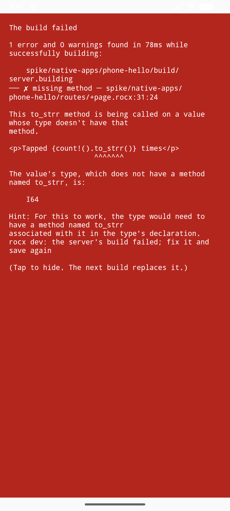
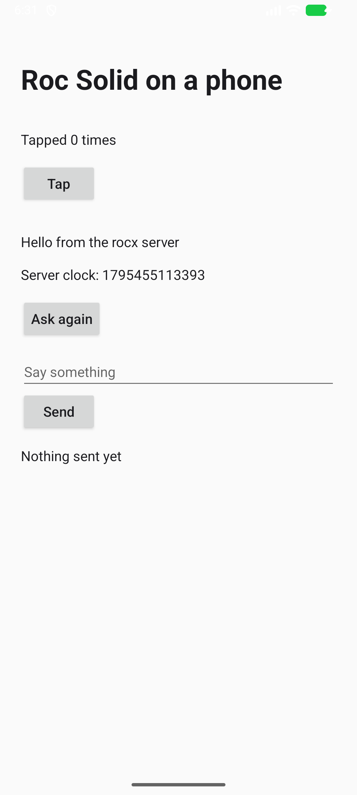

# The Android spike (D-063): a `.rocx` screen as native Android views

Built 2026-11-23 on branch `nxy7/native-android` (from `native-apps`), following
[DESIGN.md](DESIGN.md). One screen, [phone-hello](phone-hello/), runs as real Android views on
the emulator, with no JavaScript and no WebView, and talks to the app's rocx server with the same
typed endpoint calls the browser makes (`Api`, D-037). The same `.rocx` runs unchanged in a
browser.

```
spike/native-apps/phone-hello/routes/+page.rocx
   │ rocx build --client                       (the browser's copy: main.roc on web/platform)
   ├─roc --target=wasm32 ──► app.wasm + web/runtime.js                 the browser, as before
   └─roc --target=arm64musl ──► libapp-roc.a (the app alone, an archive)
                                   │ NDK clang, with native/android + native/core (Rust)
                                   ▼
                     lib/arm64-v8a/libapp.so ──JNI──► Kotlin applier ──► android.widget.*
```

## What it is

- **`native/core`** (Rust, no Android code): web/platform's 49 hosted functions
  (`src/hosted.rs`), and the reactive engine they drive, a port of `web/runtime.js` without the DOM
  (`src/engine.rs`): computations, signals, memos and their waits, `<Loading>`, `<Errored>`,
  `<Show>`, `<For>`, contexts, effects and render effects, cleanups, handlers that wait for the
  server and run again, actions and submissions, timers, titles. It builds a document of its own,
  as the browser builds the DOM (`src/dom.rs`: elements, text, the comment pairs that mark a hole's
  range, fragments), so it can follow runtime.js step by step. After each flush the document is
  projected onto native views and compared with what was sent last (`src/native.rs`): one batch of
  ops a flush. A CSS subset (`src/css.rs`) resolves the page's stylesheet into the views'
  properties. An HTTP/1.1 client (`src/http.rs`) asks the server on threads of its own.
- **`native/android`**: the Android half in Rust (`src/lib.rs`: `JNI_OnLoad`, `Rocx.start` and
  `Rocx.send`, the main looper's wake pipe, logcat), and the Kotlin shell (`app/`): one activity, and
  an applier that walks a batch of ops into Android views (a box is a `LinearLayout`, text a
  `TextView`, `<button>`, `<input>` and checkboxes the platform's own). `build.sh` builds an app's
  APK, or the dev client.
- **`native/android-dev`** and **`rocx dev --android`**: the dev mode (below). The dev client is the
  same shell with the host as `libhost.so` and no app in it; it loads each build `rocx dev` makes.
- **`native/mac`**: the same engine and ops on the Mac, with a recording renderer: it mounts an app
  built for `arm64mac`, prints the screen as an outline, and takes taps and typing as steps. It is
  how the engine was debugged, and the build uses it to say what a phone ignores.
- **`web/platform/main.roc`** gains two targets, `arm64musl` and `arm64mac`, each the app alone as
  an archive. Nothing else in `web/` changed; `web/runtime.js` is untouched.
- **`spike/native-apps/phone-hello`** (here, not in `examples/`, where every app has a page on the
  docs site): one page with a counter (a signal, a button, a text hole), a value
  read from `GET /api/greeting` through `Api` with `Endpoint.get!` in a memo, shown under
  `<Loading>` and `<Errored>`, with "Ask again" (`refresh!`), and a field whose text a button sends
  to `POST /api/echo` with `Endpoint.send!(Api.post_api_echo({}), { text }, Call.fetch!)`, from a
  handler that waits for the answer, which is typed (`{ shout : Str, length : U64 }`, or a refusal).

## Setting up

Already on this Mac: the Android SDK (`~/Library/Android/sdk`: platforms 36 and 37, build-tools 35
and 36, the emulator, the arm64 API 37 image and the AVD `Medium_Phone_API_37.0`), Android Studio's
Java 25 (JBR) and its Kotlin compiler (`plugins/Kotlin/kotlinc`, Kotlin 2.3.20), Zig and Rust from
Nix.

Installed for the spike:

| What | How | Where |
|---|---|---|
| Android NDK 30.0.16248370 (2.8 GB unpacked) | Nix: `NIXPKGS_ALLOW_UNFREE=1 NIXPKGS_ACCEPT_ANDROID_SDK_LICENSE=1 nix build --impure --out-link ~/rocx/.tools/android-ndk nixpkgs#androidenv.androidPkgs.ndk-bundle` | `/nix/store/…-android-sdk-ndk-30.0.16248370`, a GC root at `.tools/android-ndk` (the shared `.tools`) |
| Rust's std for `aarch64-linux-android` | `rustup target add aarch64-linux-android` on the repo's rustup toolchain (`RUSTUP_HOME=.tools/rust/rustup CARGO_HOME=.tools/rust/cargo`, Rust 1.100.0); Nix's Rust (1.99, no rustup) has no way to add a target | `.tools/rust/rustup/toolchains/stable-aarch64-apple-darwin/lib/rustlib/aarch64-linux-android` |

Nothing else: no Gradle download (the SDK's own tools build the APK), no change to the shell's
config or dotfiles, and the AVD runs with `-read-only`, so its own files don't change either.

## Building and running

```sh
# The app's server, on the Mac (the emulator reaches it at 10.0.2.2:8095)
bin/rocx dev spike/native-apps/phone-hello --port 8095

# The APK: native/android/build/phone-hello/phone-hello.apk
native/android/build.sh spike/native-apps/phone-hello --origin http://10.0.2.2:8095 --label "Phone hello"

# The emulator (headless, its AVD left as it is), the APK installed and opened
~/Library/Android/sdk/emulator/emulator -avd Medium_Phone_API_37.0 -no-window -no-audio \
    -read-only -no-snapshot-save -gpu host -cores 4 -memory 4096 &
adb install -r native/android/build/phone-hello/phone-hello.apk
adb shell am start -n dev.rocx.example.phonehello/dev.rocx.phone.RocxActivity
adb logcat -s rocx                                  # the host's log: timings, CSS ignored

# The evidence (screenshots, the views, the APK's contents, timings), with adb alone
spike/native-apps/evidence/run.sh
# The same .rocx in a browser (Chromium's headless shell)
node spike/native-apps/evidence/web-check.mjs

# The app on the native host, on the Mac (no phone)
ROCX_APP_ARCHIVE=$PWD/native/android/build/phone-hello/libapp-mac.a cargo build --manifest-path native/Cargo.toml -p rocx-native-mac
native/target/debug/rocx-native-mac --origin http://127.0.0.1:8095 show wait:800 tap:Tap type:hello tap:Send wait:800 show
```

`build.sh` runs, in order: `rocx build --client`; `roc build --target=arm64musl` (an archive);
`cargo build --release --target aarch64-linux-android -p rocx-android` (a static library); one link
by the NDK's clang into `lib/arm64-v8a/libapp.so` (exporting only `JNI_OnLoad` and the two JNI
functions, 16 KB pages); kotlinc and R8 for the shell (again only when it changed); `aapt2 link`,
the dex and the library zipped in (the library stored, `extractNativeLibs="false"`), `zipalign -P
16`, `apksigner` with a key of the spike's own (`native/android/build/spike.keystore`); then the app
built for the Mac and mounted once by `native/mac`, whose warnings are printed as `phone: …`.

## Dev mode: `rocx dev --android`

An Expo-like loop: save a `.rocx` file, and the phone shows the change in about a second, with no
reinstall. Built 2026-11-23, after the spike, at the user's request.

```sh
native/android/build.sh --dev-client            # once (and when native/ or web/platform's header changes)
bin/rocx dev spike/native-apps/phone-hello --port 8095 --android
```

`rocx dev --android` does what `rocx dev` does (builds the app, serves it, builds again on each
save) and, with each build, builds the app's Roc for the phone too. At start, if `adb` sees the
emulator or a phone on USB, it reverses the server's port to it, installs the dev client if it
isn't there, opens it at `http://127.0.0.1:<port>`, and shows the phone's log (`adb logcat`, the
`rocx` tag) in the terminal. A phone on Wi-Fi: open the dev client, give it the computer's address,
and run the server reachable (`-- --host 0.0.0.0`).

- **The dev client** (`build.sh --dev-client`: `rocx-dev.apk`, `dev.rocx.devclient`, 808 KB) is the
  Kotlin shell with the host as `libhost.so` (`native/android-dev`: native/android's `dev` feature
  and native/core's `dynamic` one), which exports the 49 hosted functions and Roc's memory
  functions, and no app. Every 150 ms it asks the server for `/rocx/android/latest.json`; a new
  build's library is downloaded into the app's files and loaded in place of the last
  (`Rocx.reload`: `dlopen`, `roc_mount` and `roc_run` from `dlsym`).
- **A build for the phone** (`rocx-cli/Dev.roc`, `phone_build!`): the browser's copy compiled by
  Roc's dev backend for `arm64musl` (0.2–0.4 s for this app, against 2.6 s for `--opt=speed`),
  linked by the NDK's clang into `app-<build>.so` against a stub `libhost.so` (so it needs the dev
  client's by name), served from `build/android/static` (one more `--static` directory). It is
  announced (`latest.json`) once the server built with it has started, so the phone's first reads
  find it up; the host's HTTP client also tries a refused connection again for up to 3 s.
- **A reload** restarts the engine (the last build's Roc values are dropped, never released: their
  code may be gone; answers and timers from it carry its generation and are ignored), mounts the new
  build, types again what was typed in the fields (`input` events, so the app's signals have it),
  and keeps the scroll. Load and mount take 3–13 ms. Signals reset otherwise: Roc values are laid out
  by the code that made them, which the new build may have changed (Expo's Fast Refresh keeps
  component state; this doesn't, yet).
- **Errors.** A build that fails shows the compiler's report, pointed into the `.rocx` file, on a red
  screen until the next build. A build for another platform (the fingerprint of web/platform's
  `main.roc` and `Host.roc` and the Roc compiler, made by `native/core/build.rs` and by `rocx dev`,
  differs) says to rebuild the dev client. A build that crashes the dev client natively (its
  library's code ends the process while it loads or mounts) is shown on the red screen at the next
  start instead of being loaded again.
- **Store rules.** Loading downloaded native code is fine in a debug build; Google Play bans it in a
  release, so this is the dev client's alone: an app's APK links its Roc in (`libapp.so`).

Measured with `evidence/dev-loop.sh` (an edit of the page's heading, typed text in the field, then a
mistake, then its fix), on the Mac's clock from the file's write to the client's "shown" line in
`rocx dev`'s output:

| | |
|---|---|
| A `.rocx` edit, on the phone | 0.77–1.3 s after the save (100 ms debounce, the build 0.2–0.7 s, the server's restart, the 150 ms poll, the download 7–14 ms, load and mount 3–13 ms) |
| A mistake, on the red screen | 0.39–0.46 s after the save |
| What was typed | kept across builds, and in the app's signal (`Send` posts it) |

 

`dev-01-before.png`, `dev-02-reloaded.png` (the new heading, the field's text kept, the counter back
at 0), `dev-03-error.png`, `dev-04-fixed.png`, `dev-05-crash-guard.png` (a library whose
`roc_mount` writes to address 0, served as a build, and the client after it) and `dev-loop.txt`.
On the Mac, loading the app as a `.dylib` to test reloads there doesn't work yet: the Mach-O library
writes to Roc's constant data (in `__DATA_CONST`, read-only once loaded), where the Android library
doesn't; the loop is tested on the emulator instead.

## How Roc gets onto Android

The fork has no Android target, but it has what the spike needed: an `Archive` output (a static
archive of the compiled app and the target's inputs) and static Linux targets. Built for
`arm64musl` with `inputs: [app]`, the app is two ELF objects for AArch64 (the app, position
independent, and its static data) whose only undefined symbols are Roc's own (`roc_alloc`,
`roc_crashed`…) and the hosted functions: no C library at all, since Roc's code calls the host for
everything. AArch64 ELF is AArch64 ELF, so the NDK's clang links that archive with the Rust host
into an Android library as it is.

So the spike changes nothing in the compiler, and the repo's pinned one (`.tools/roc-active`,
`9fcf362c0c`) builds it. `arm64linux` (glibc) would have done as well, but the fork builds glibc
targets only on Linux. A fork target `arm64android` would add little: the library's name, and
`output: Shared` so Roc could link `libapp.so` itself with a `libhost.a` in
`web/platform/targets/arm64android/`, as the design had it. It can wait until there is a reason (an
Android-only builtin, say).

The user's choice (2026-11-23): native code for the app's Roc, no over-the-air updates for now
(DESIGN.md, "Later").

## How it runs on the phone

- **One thread.** `Rocx.start` (in the activity's `onCreate`), `Rocx.send` (a view's event) and the
  looper's callback all run on the main thread: the engine, Roc and the applier, as the browser runs
  the wasm and runtime.js on its main thread. A request or a timer waits on a thread of its own,
  posts what happened, and writes a byte to a pipe the main `ALooper` watches; the callback drains
  it and runs `pump` (answers in, a flush, one batch out).
- **A read that isn't in yet** (`Endpoint.get!` before the answer, a memo without its first value)
  ends its computation the way the server's host ends a failed one: the hosted function notes why
  and `longjmp`s back to the computation's guard (`guard.c`, the server's). The engine then does
  what runtime.js does with `NotReady`: the nearest `<Loading>` shows its fallback, and the
  computation runs again once the answer is in. A handler that waits (`Endpoint.send!`) has its
  writes dropped and runs again with the answer, so the POST is typed end to end.
- **One JNI call a flush.** The engine projects its document onto views after each flush and sends
  only what changed, as bytes, to `Rocx.apply`. A batch: `CREATE id kind tag`, `SET id key value`,
  `CHILDREN id [ids]`, `DESTROY id`, `ROOT id`, `TITLE text` (`native/core/src/native.rs`). A `<p>`
  whose content is text is one `TextView`, its whitespace collapsed as CSS does; text beside blocks
  gets an anonymous `TextView`. The mount sends 2,975 bytes for 15 views.
- **Events** come back as `(id, name, value)`: a tap is `click`, typing is `input` with the field's
  text, the keyboard's done key `keydown Enter`, focus and blur, a checkbox's `click` and `change`.
  They bubble up the engine's document as the DOM's do, and a tap on a form's submit button submits
  the form (an endpoint's form a component reads the submission of is sent with the host's client).

## What works (evidence)

All of it in [evidence/](evidence/), made by `evidence/run.sh` and `evidence/web-check.mjs`:

| | |
|---|---|
|  | `01-before-taps.png`: just launched. The GET is on its way (`run.sh` puts a proxy that waits 2.5 s in front of the server; the emulator's own `network delay` doesn't slow 10.0.2.2), so `<Loading>`'s fallback, "Asking the server…", shows. |
|  | `02-get-answered.png`: the answer is in: `{ message, at }`, typed, from the server on the Mac. |
|  | `03-after-taps.png`: three `adb shell input tap`s on "Tap". |
|  | `04-post-answered.png`: `adb shell input text "hello phone"`, then "Send": `POST /api/echo` and its typed answer. |
|  | `05-post-refused.png`: the field emptied and sent again: the server's 422, as the typed answer's `Err`. |

- `evidence/uiautomator.xml` and `views.txt`: the hierarchy is `ScrollView`, `LinearLayout`,
  `TextView`, `Button` and `EditText`, all `android.widget.*`; no WebView.
- `evidence/apk-contents.txt`: the APK holds `classes.dex` (the shell, and what R8 keeps of
  Kotlin's library) and `lib/arm64-v8a/libapp.so`, which needs only `libc`, `libm`, `libdl`,
  `liblog` and `libandroid`, exports only JNI, and has no JS engine's symbols; no class uses
  `android.webkit` or JavaScript.
- `evidence/web.png` and `web-check.mjs`: the same page in Chromium, hydrated by `web/runtime.js`,
  three taps, the GET, the POST.
- On the Mac (`native/mac`), against the same server: the screen before and after the GET, taps,
  typing, the POST and its refusal, "Ask again" (`refresh!` reads the server's clock again), and,
  with the server down, `<Errored>`'s fallback with the request's failure and "Again".
- `web/runtime.js` is unchanged: `git diff $(git merge-base HEAD master) -- web/` shows only
  `web/platform/main.roc`'s two new targets. The web platform's tests pass, 46 of 46
  (`evidence/web-tests.txt`, through `/tmp/rocx-gate.sh`).
- Beyond the screen, two of `web/test/app`'s pages built for the Mac and driven by `native/mac`
  behave as they do in the browser: `effects_app.roc` (an effect's runs and cleanups in order, an
  interval counting until its `<Show>` hides it, `Browser.call!` and the `listen!` stub failing
  with why) and `picks_app.roc` (a keyed `<For>` keeping and moving its rows on reverse, adding,
  its fallback when empty, an unkeyed one by position, `<Show>`, a context).

## The hosted functions

All 49 are there. 40 do what runtime.js's imports do: `keep!`, `signal_new!`, `signal_get!`,
`signal_set!`, `memo_new!`, `memo_done!`, `memo_get!`, `refresh!`, `is_pending!`, `fail!`,
`event_value!`, `boundary!`, `problem!`, `retry!`, `for_new!`, `row_index!`, `row_set!`,
`row_get!`, `context_value!`, `context_find!`, `context_get!`, `location!` (the start path, `/`),
`fetch!`, `timeout!`, `interval!`, `clear_timer!`, `now_millis!`, `now_nanos!`, `effect_new!`,
`effect_options!`, `cleanup!`, `action!`, `submission!`, `submissions!`, `submission_clear!`,
`submission_drop!`, `submit!`, `title!` (the activity's title), `untrack!`, `read_at!`. The screen
uses about half of them; the others are ported but untested until phase 0's conformance suite runs
`web/test/app` on both engines.

Three answer what the browser's do: `request!` (none), `status!` (nothing), `flash!` (none).

Stubs, each failing with why (the nearest `<Errored>` shows it, or a handler's failure is logged):
`listen!`, `subscribe!`, `say!` and `resync!` ("… isn't on phones yet (D-063's spike)"), and
`live_publish!`, which fails as the browser's does (the server's). `browser_call!` is queued as the
browser's is, and then logged: no native handler is registered yet ("the audio plugin has no native
half yet").

In the markup, what isn't on phones yet is warned of once and ignored: `on:frame`,
`on:viewport`, transitions, keys (`key=`), `<Document>`/`<Window>` handlers, `<NoHydration>` (empty:
it is the server's).

## CSS

The design compiles CSS at build time; the spike reads the stylesheet the page carries (rocx's
scoped `Generated/Styles`, in a `<style>`), after a phone user-agent sheet (h1–h6, p, lists,
strong, em, small, a). Selectors: type, class, id, `*`, `:root`, `:global()`, descendant and child.
Properties: `display` (none; flex as a row or a column; the rest a column), `flex-direction`, `gap`,
`padding`, `margin` (collapsed between a column's children), colours and backgrounds, `font-size`,
`font-weight`, `font-style`, `text-align`, `text-transform`, `border-radius`, `border`, `width`,
`height`, `opacity`, `align-items`, `justify-content`, custom properties and `var()`; px, rem, em
and pt; `@media` on width and colour scheme. Anything else (a property, a pseudo-class, an
at-rule) is warned of once, `rocx: CSS … isn't on phones yet: ignored`, in logcat and, at build
time, by `build.sh` (`phone: …`), and never fails the build: the user's answer to question 1.

## Measurements

The Mac was shared with other sessions' builds the whole time (load average 8–12 while measuring,
over 100 earlier); the emulator is `Medium_Phone_API_37.0` (arm64, API 37) with 4 cores and the
host's GPU.

| | |
|---|---|
| APK | 983,554 bytes (960 KB): `libapp.so` 940,664 bytes, stored uncompressed (`extractNativeLibs="false"`); `classes.dex` 35 KB |
| In `libapp.so` | 766 KB of code; the app's Roc is about 186 KB of it, the rest the host (the engine, Rust's std, serde_json, jni) |
| Build, first | 81 s (the host built from nothing by cargo, under load) |
| Build, a `.rocx` changed | 4.2–4.5 s (Roc 2.5–3 s; the Mac's check about 1 s) |
| Build, the Kotlin shell changed | 10–18 s (kotlinc's start, R8) |
| Launch to first frame (cold, `am start -W`) | 114–220 ms over 9 launches; 353 ms for the first launch after the emulator booted |
| In it: `libapp.so` loaded | 1–11 ms |
| In it: the app mounted, first batch applied | 4–40 ms (2,975 bytes of ops, 15 views) |
| A tap to the screen patched | 0.14–0.60 ms (the handler, the flush, the ops applied; logcat `tap on #…`); a "Send" that starts a request up to 2.4 ms |
| On the Mac (`native/mac`, a debug build) | mounted in 1.3–2.5 ms |

## Gaps and next steps

1. **Phase 0's conformance suite.** The engine is a port of runtime.js, checked only on this screen
   (and its paths on the Mac). `web/test/app` run on both engines, the native tree compared with
   Chromium's DOM after each step, is what makes the other half of the hosted functions trusted.
2. **What a run that waits leaves behind.** The jump past Roc's frames leaks what they held (a few
   allocations a wait; `live allocations` is 21 after the Mac run above). The browser's host frees
   it (frames, `reclaim`) and the server's frees a failed run's list; the same is needed here.
   Nodes taken off the engine's document stay in its arena too, and every request's answer stays
   in its table.
3. **Layout.** `LinearLayout`s, not Taffy: blocks stack, a flex box is a row, margins collapse
   between siblings only. Inline blocks don't share a line (the field and "Send" do in a browser,
   not here), and grid, `%` lengths, positioning and wrapping aren't there. Taffy (the design's)
   is the next step for any second screen.
4. **CSS at build time.** Parsed on the phone now; the design's build-time table (and `rocx check
   --android`) gives file and line to each warning.
5. **The server over HTTP.** Plain `http://` only, a connection a request, no cookies (no sessions),
   no streaming (so no `listen!` or channels). Next: rustls with the platform's roots, keep-alive,
   a cookie jar in the app's files, server-sent events.
6. **Pages.** One page at its start path; no navigation, links or back gestures (D-040's shape, §8);
   page guards are ignored (the user's answer to question 4).
7. **`rocx build --android`, and the dev mode's next steps.** `build.sh` is the spike's. The dev mode
   (above) reloads in about a second; next: keeping signals across a reload where their types
   didn't change, a QR code for a phone on Wi-Fi, the server's restart off the reload's path, and
   the dev client's log forwarded over HTTP (no `adb` needed).
8. **Controls.** Images, `select`, SVG, `textarea` sizes, dark mode, accessibility roles, the
   keyboard's other keys (only Enter), `on:submit` from the keyboard.
9. **Typing.** Once, `adb shell input text` typed while the keyboard was still starting gave a
   doubled first letter ("hhello"); with the keyboard up it never did. Whether that is adb and
   Gboard or the applier isn't settled (a plain `EditText` app would tell).
10. **Release.** A real key and signing, other ABIs (`x86_64` emulators), a launcher icon.
11. **iOS**: the same `native/core`, an objc2 applier, and a fork target for Xcode's link.
